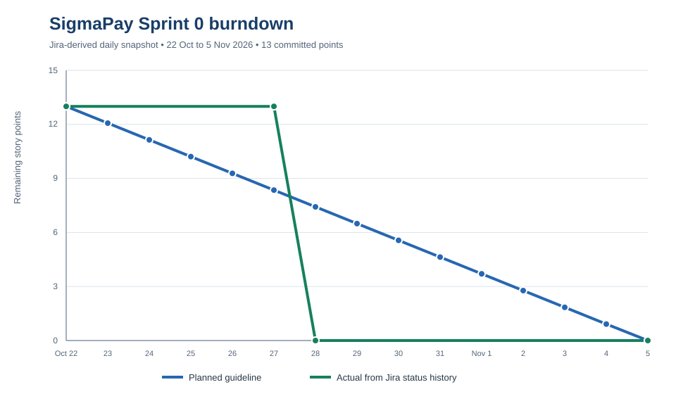

# PM2 project management evidence

Sources: `SigmaPay_SprintPlan_and_Burndown.xlsx` plus the connected Jira SCRUM board (board 1), checked 2026-11-25. The workbook supplies the story rows and estimates; Jira is the current source for sprint state, assignments, and issue history. Figures preserve recorded issue transitions and do not rewrite sprint history.

## Sprint summary

| Sprint | Jira state in snapshot | Planned points | Done points | Remaining points | Velocity | Estimation error |
| --- | --- | ---: | ---: | ---: | ---: | --- |
| Sprint 0 | Active; date window ended 2026-11-05 | 13 | 13 | 0 | Planned 13; actual 13 | 0.0% |
| Sprint 1 | Future; proposal goal set; dates unset | 13 | 0 | 13 | Not finished | Not calculable |

Sprint 0 is marked Active even though all 13 committed points are Done and the recorded end date passed. The team should verify acceptance and close the sprint in Jira without changing historic issue completion dates. Sprint 1 now follows the proposal next slice. Dates remain unset until the team confirms capacity and timing; its actual burndown will be recorded after start.

The proposal's initial plan (US1, US3, and US5; 13 points) is complete in Jira Sprint 0. The future Jira Sprint 1 now contains the proposal's next slice (US6, US9, and US24; 13 points). US4 and US7 returned to the backlog. Sprint 1 remains Future with no dates until the team confirms its capacity and schedule.

Estimation error for the finished sprint is `abs(planned velocity - actual velocity) / planned velocity`: `abs(13 - 13) / 13 = 0.0%`. Jira's existing US1–US24 point fields match the proposal's Fibonacci estimate table. The proposal labels these planning estimates for Planning Poker review but contains no vote record. No M2 product story was created or changed, so SCRUM-47 remains a zero point Task. The repository's Docker, microservice, and front end work is reflected in the M2 implementation evidence; do not add points to it without Poker.

## Sprint 0 committed stories

| Jira | Story | Points | Owner | Status |
| --- | --- | ---: | --- | --- |
| [SCRUM-18](https://aiu-team-jkoscu8b.atlassian.net/browse/SCRUM-18) | Register an account | 5 | Ammar | Done |
| [SCRUM-20](https://aiu-team-jkoscu8b.atlassian.net/browse/SCRUM-20) | Update profile | 3 | Ammar | Done |
| [SCRUM-22](https://aiu-team-jkoscu8b.atlassian.net/browse/SCRUM-22) | Create category budgets | 5 | Mohammed Eslam | Done |

## Sprint 1 assigned stories

| Jira | Story | Points | Owner | Status |
| --- | --- | ---: | --- | --- |
| [SCRUM-23](https://aiu-team-jkoscu8b.atlassian.net/browse/SCRUM-23) | Record and categorize an expense | 5 | Mohammed Eslam | To Do |
| [SCRUM-26](https://aiu-team-jkoscu8b.atlassian.net/browse/SCRUM-26) | Create and track financial goal | 5 | Omar | To Do |
| [SCRUM-45](https://aiu-team-jkoscu8b.atlassian.net/browse/SCRUM-45) | Review service health | 3 | Andrew | To Do |

## Proposal ownership applied to Jira

The user directed us to use the proposal's suggested owners. Jira story assignees now follow that map: US1–US4 account/auth and US18–US19 payments to Ammar; US5–US8 budgets/trends and US15–US16 reports to Mohammed Eslam; US9–US12 goals/group savings to Omar; US13–US14 investments/advisory and US21 tutoring to Andrew; US17 card activity, US20 offers, and US22 notifications to Mohamed Ibrahim. US23–US24 retain their existing assignees because the proposal does not allocate those two admin/platform stories to a named member. SCRUM-47 is assigned to Ammar for project coordination.

Jira's existing US1–US24 story point values match the proposal's Fibonacci estimate table. The proposal describes them as planning assumptions to review with Planning Poker, not as recorded voting results. No product story was created or changed for M2, so no new story estimate was added; SCRUM-47 is an unestimated Task. Keep the Poker outcome labeled provisional until the team records its vote.

After the Jira sprint change and excluding duplicate SCRUM-28, the workbook shows 118 planned points in the backlog, with 110 remaining. SCRUM-19 (8 points) is Done but remains in the backlog, so completed points there are shown separately. Jira now also has SCRUM-47, a zero point PM2 tracking task in the backlog.

## Burndown evidence

Jira confirms Sprint 0 (ID 2) ran from 2026-10-22 to 2026-11-05 and all three committed stories are Done. Issue history shows SCRUM-18, SCRUM-20, and SCRUM-22 all changed to Done on 2026-10-28, so remaining work is 13 points until that date and 0 points afterward. The workbook's existing visual is explicitly illustrative and does not represent those Jira history values. Jira's sprint-data connector does not expose the native burndown chart or screenshot. Capture that native chart from Jira before submission; Sprint 1 (ID 1) is Future with no dates, so no actual Sprint 1 burndown exists yet.

The derived plot below uses the Jira sprint dates and issue history. Its planned guideline is a straight line from the sprint's 13 points to zero; the actual line reflects the recorded completion date. It is a derived evidence chart, not a Jira screenshot.

The SVG is attached to [SCRUM-47](https://aiu-team-jkoscu8b.atlassian.net/browse/SCRUM-47) and committed at `DOCS/PM2/sprint0-burndown-jira-derived.svg`. The Jira report page itself redirects to Atlassian sign in in the available browser session; the Jira connector does not expose chart screenshots.

## M2 addition candidates

These are implementation gaps identified in the local code, not yet Jira stories or estimates:

| M2 work item | Repository evidence | Jira status / estimate |
| --- | --- | --- |
| Add executable TypeScript service tests and coverage to CI | 13 tests in `backend-server/test`; `.github/workflows/ci.yml` | Tracked in SCRUM-47; no point estimate set |
| Enforce SonarQube quality gate | `.github/workflows/ci.yml`; `sonar-project.properties` | Conditional configuration is in place; live host/token still required |
| Add Jenkins pipeline and document comparison | `Jenkinsfile`; `DOCS/PM2/DEVOPS.md` | Pipeline file is in place; Jenkins controller/run still required |
| Complete diagrams and test interactions for proposed owner scenarios | `DOCS/PM2`; tests under `backend-server/test` | Five representative scenarios mapped to the proposed owners selected by the user; the proposal labels the mapping provisional |
| Align dashboard UI with the software requirements and documented limits | `frontend-client/src` and landing page skill rules | Revised in repo; local production build succeeds |

## Jira board

[SigmaPay SCRUM board backlog](https://aiu-team-jkoscu8b.atlassian.net/jira/software/projects/SCRUM/boards/1/backlog). The checked in workbook is an editable snapshot, not a live Jira export. Update the Jira board with any newly estimated stories and preserve the same sprint assignment, points, and status in the workbook.

The connected Jira project now contains [SCRUM-47](https://aiu-team-jkoscu8b.atlassian.net/browse/SCRUM-47), an unestimated backlog task tracking M2 artifacts and outstanding team/service evidence. It is intentionally not assigned to Sprint 1. Jira keeps Sprint 0 Active despite its ended dates and Sprint 1 Future with proposal scope. Do not change Sprint 0 history. Sprint 1 dates remain unset pending team capacity and schedule agreement.
